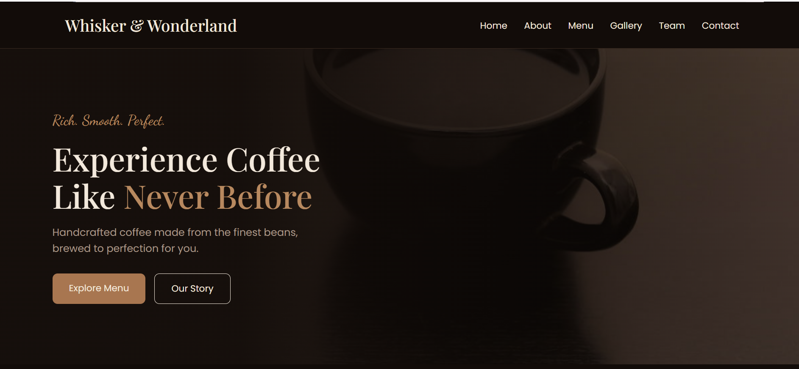
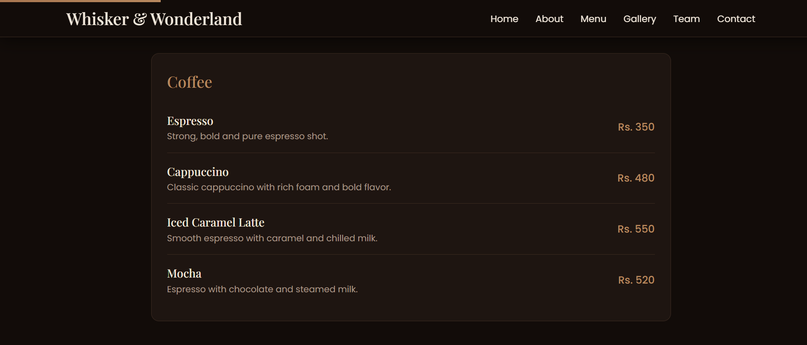
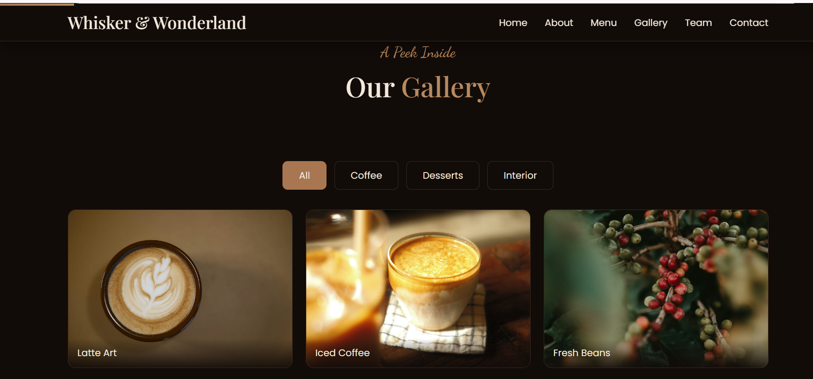
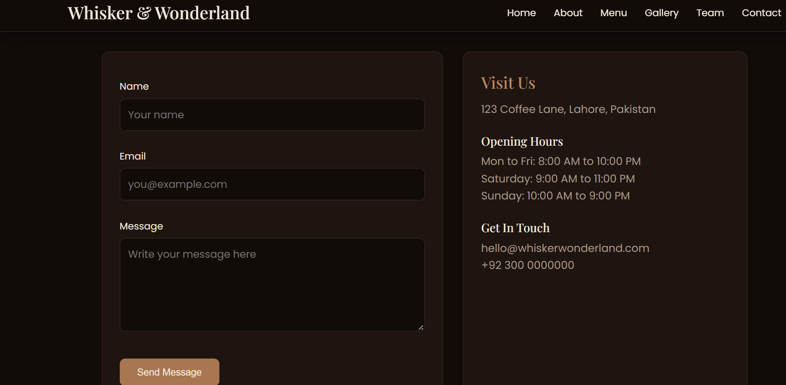
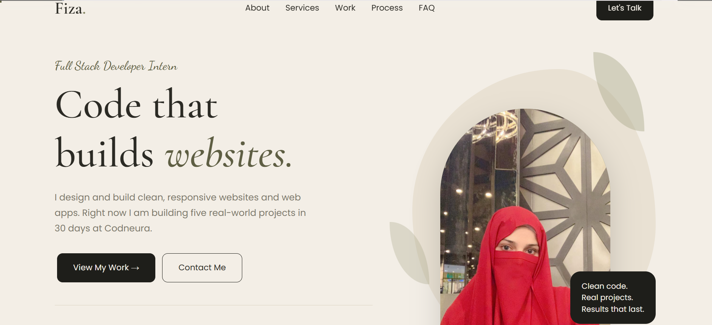

# Business Website: Whisker & Wonderland

Codneura Internship, Project 1 (Business Websites)

An aesthetic, responsive website for a coffee shop, plus a personal developer portfolio.

## Live Preview
- Coffee shop website: https://fiza-insights.github.io/Business-Website/
- Personal portfolio: https://fiza-insights.github.io/Business-Website/personal-portfolio/

## Screenshots

## Features
- Six pages: Home, About, Menu, Gallery, Team and Contact
- Responsive layout for mobile and desktop
- Gallery with category filters (Coffee, Desserts, Interior)
- Contact form with validation (name, email and message checks)
- SEO basics: page titles, meta descriptions, image alt text, semantic HTML
- Scroll animations, animated navbar and hover effects
- Personal portfolio with animated sections and project links

## Technologies
HTML5, CSS3, JavaScript, Formspree (contact form email), GitHub Pages (hosting), Git and GitHub, VS Code

## How to Run
1. Download or clone this repository.
2. Open the folder in VS Code.
3. Right-click `index.html` and choose "Open with Live Server".
4. The portfolio is in the `personal-portfolio` folder.

## Contact Form
The form is validated in JavaScript and delivered by email through Formspree. No separate database is used in this project, so there is no SQL file.

## Credits
- Photos: Unsplash (https://unsplash.com), free to use under the Unsplash License
- Fonts: Google Fonts (Playfair Display, Poppins, Dancing Script, Cormorant Garamond)
- Contact form service: Formspree

## Author
Fiza Saleem, Full Stack Developer Intern, Codneura
Email: fiza.cm26.9214@gmail.com
GitHub: https://github.com/Fiza-insights